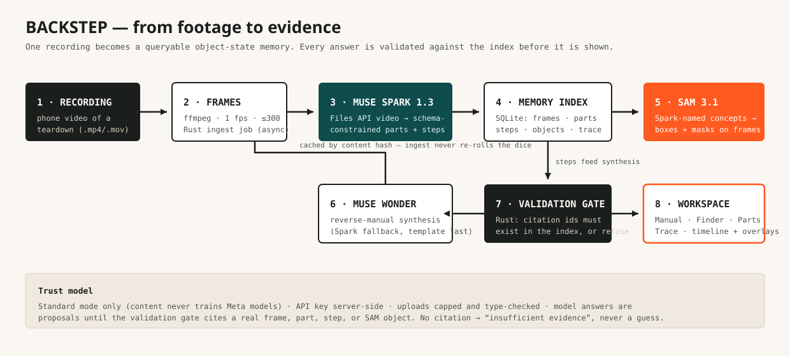

# Backstep

### The rewind button for the real world.

**Film a teardown once. Backstep remembers every part and every step — then replays
reassembly from your own hands and finds the part you lost, with the exact frame as proof.**

Built for the **Meta Global AI Developer Hackathon** · Indie Developer track · *Build for Your World*.



---

## The problem

Anyone who works with their hands knows this moment: you took something apart —
a kite control bar, a bike, a laptop, a pump — and the knowledge of *how it goes
back together* started evaporating the second you finished. Weeks later you are
standing over a pile of parts, scrubbing 40 minutes of phone footage by hand,
hunting for the frame where the tiny screw went.

The current workarounds are manual and lossy:

- scrubbing your own video frame by frame,
- photographing every screw into a spreadsheet,
- the ice-cube tray of sorted screws, and hope,
- generic guides (iFixit) that end with *"work the steps in reverse order"* —
  for a device that may not be yours.

The richest knowledge is created **while hands are busy**, and video is the only
medium that captures it. But video today is write-only. Backstep makes it readable.

## What Backstep does

Drop in one recording of a teardown. Backstep builds an **object-state memory**:
the parts, the order they came out, and the state of the assembly at each step.

Then, standing over the pile of parts:

- **Manual** — *"How does this go back together?"* The manual assembles itself in
  reverse out of your own footage: step-by-step reassembly instructions, each one
  pinned to the frame where that state actually happened.
- **Finder** — *"Where did I put the tiny black screw?"* The timeline scrubs
  itself to the last frame that part was seen, with its SAM 3.1 region highlighted.

**Every answer is a citation.** A claim ships only if it points at a real frame,
part, step, or SAM object in the index — validated deterministically in Rust
before it reaches the screen. If the memory doesn't contain it, Backstep says
*insufficient evidence* instead of guessing. If it wasn't seen, it isn't said.

## Who it is for

People who maintain and repair their own gear and equipment: makers, repairers,
DIYers, cyclists, PC builders, field techs — starting with the builder's own
world (kite gear maintenance). The initial wedge is deliberately narrow:
**one recording, one bench, two jobs done flawlessly** (reverse Manual + part Finder).

## Why now

- **SAM 3.1** (Meta Model API) makes promptable segmentation and tracking in
  video cheap and API-accessible ($0.20 per 1,000 video frames; $2.50 per 1,000 images).
- **Muse Spark 1.3** reads a whole recording (1M-token context, Files API video
  understanding) and returns schema-constrained structure.
- **Muse Wonder** provides the long-running agent synthesis (reverse manual,
  grounded Q&A) with active memory.
- Google Astra proved the desire for "where did I put my glasses?" — as an
  unreleased research prototype with a 10-minute session memory. Nobody ships a
  persistent, evidence-linked memory of *your hands at work*. That is the whitespace.

## Innovation

Not "it uses AI". Machines could already *describe* a video. Backstep maintains an
**object-state timeline that can be queried backwards and replayed as instructions**,
with every claim bound to a frame and a segmented region:

1. Muse Spark decides *what* to segment (short concrete noun phrases — the
   published "SAM 3 Agent" pattern); SAM 3.1 returns pixel regions, not adjectives.
2. The reverse manual is *synthesised from the user's own demonstrated steps* —
   tacit knowledge becomes a permanent, transferable artifact.
3. A deterministic citation-validation gate (no LLM in the gate) makes the
   product's honesty a property of the code, not of the prompt.

## Hackathon relevance

| Judging criterion | How Backstep answers it |
|---|---|
| **Impact (30%)** | Universal, firsthand pain (lost parts, forgotten reassembly) across repair, DIY, and gear maintenance; a capability that becomes a lasting personal asset. |
| **Use of Meta AI Tooling (25%)** | Three Meta models composed, not wrapped: Muse Spark 1.3 (video → structured steps), SAM 3.1 (concept segmentation → evidence regions), Muse Wonder (reverse synthesis + grounded answers) — plus Files API, structured output, and Responses API. |
| **Demo (25%)** | One memorable moment — *"Where did I put the tiny black screw?"* and the frame lights up — on a deterministic cached path that cannot re-roll the dice live. |
| **Technical depth (20%)** | Rust ingest pipeline (ffmpeg, content-hash caching, resumable jobs), SAM wire-grammar parser, schema-constrained extraction, deterministic citation validation, 20-case query benchmark. |

Theme: **Build for Your World** (with a Push-the-Frontier reading: *a machine gains
episodic memory of physical work*).

## Architecture

```
backend/   Rust (Axum, Tokio, rusqlite, reqwest)
  src/main.rs    HTTP API: recordings, frames, manual, ask (citation-validated), parts, trace
  src/ingest.rs  ffmpeg frames → Meta Files upload → Spark extraction → SAM evidence → reverse manual
  src/meta.rs    Meta Model API client (Files, Responses, Chat Completions, SAM)
  src/sam.rs     SAM 3.1 special-token output parser (+ unit tests)
  src/sample.rs  Clearly-labelled precomputed sample memory (kite control bar)
web/       Next.js + TypeScript — timeline-spine workspace (Manual / Finder / Parts / Trace)
data/      recordings, extracted frames, SQLite index, response cache (gitignored)
scripts/   benchmark.py — 20 labelled Finder/Manual cases
```

Data flow: recording → frames (1 fps) → Muse Spark structured extraction
(parts + steps) → SAM 3.1 segmentation on each part's evidence frame → SQLite
object-state index → Muse Wonder reverse synthesis → citation-validated answers.

Frontend ↔ backend: Next.js rewrites `/api/*` and `/health` to the Rust service
(`BACKSTEP_BACKEND`, default `http://127.0.0.1:8787`).

## Running

### Prerequisites

- Rust (stable), Node ≥ 20 + pnpm, ffmpeg + ffprobe on PATH
- A Meta Model API key (`MODEL_API_KEY`) for live analysis — get one at
  [dev.meta.ai](https://dev.meta.ai) (hackathon participants receive $150 credits).
  Without a key the app still runs: sample memory + frame extraction work, and
  uploads honestly stop at `awaiting_key`. Nothing is faked.

### Start

```bash
# backend (terminal 1)
cd backend
MODEL_API_KEY=your_key cargo run            # http://127.0.0.1:8787

# frontend (terminal 2)
cd web
pnpm install
pnpm dev                                    # http://localhost:3000
```

Production build: `make build` (release backend + Next.js build), then
`cargo run --release` in `backend/` and `pnpm start` in `web/`.

### Environment variables

| Variable | Required | Meaning |
|---|---|---|
| `MODEL_API_KEY` | for live analysis | Meta Model API bearer key (server-side only) |
| `META_BASE_URL` | no | default `https://api.meta.ai/v1` |
| `PORT` | no | backend port, default `8787` |
| `BACKSTEP_DATA_DIR` | no | storage dir, default `../data` (relative to `backend/`) |
| `BACKSTEP_BACKEND` | no | frontend rewrite target, default `http://127.0.0.1:8787` |
| `NEXT_PUBLIC_BACKEND_URL` | no (set in `web/.env.local`) | browser → backend direct URL, bypasses the Next.js proxy for large uploads |

### Tests

```bash
make test                                   # Rust unit tests (SAM parser)
python3 scripts/benchmark.py                # 20-case Finder/Manual benchmark (backend running)
```

Benchmark result at build time: **20/20** against the sample memory, including
four *insufficient-evidence* cases (e.g. "Where are my car keys?") that must refuse.

## Demo — what to try first

1. Open the app. The **sample memory** (kite control bar teardown, labelled
   diagrams) is loaded. Scrub the timeline; watch parts light up on their
   evidence frames.
2. Open **Finder** and ask *"Where did I put the trim cleat screw?"* — the view
   jumps to the exact frame with the region boxed. Click any citation chip.
3. Open **Manual** — reassembly in reverse, each step clickable to its evidence.
4. Ask something the memory cannot know (*"Where are my car keys?"*) — Backstep
   refuses rather than guessing. That refusal is a feature.
5. With a key set: upload your own teardown (.mp4, ≤ 200 MB), watch the **Trace**
   tab narrate ffmpeg → Meta Files → Muse Spark → SAM 3.1 → Muse Wonder, then
   ask it where *your* screw went.

## Verification — what is real vs. simulated

**Real and working:**
- Rust backend, ffmpeg frame extraction, SQLite index, full HTTP API.
- Meta Model API integration (Files upload, Muse Spark structured video
  extraction, SAM 3.1 image segmentation with a hand-written wire-grammar
  parser, Muse Wonder/Spark synthesis) with content-hash response caching.
- Deterministic citation validation: model-proposed citation ids that don't
  exist in the index are dropped; answers without a valid citation are refused.
- 20-case benchmark (above) + SAM parser unit tests.

**Deterministic by design, and labelled as such:**
- The bundled **sample memory**: precomputed parts/steps/boxes over labelled
  diagram frames ("SAMPLE FRAME — NOT REAL FOOTAGE" is printed on every frame).
  It demonstrates the Manual/Finder/evidence model. It is never presented as
  live model output.

**Requires your API key to exercise:**
- Live ingest analysis of uploaded videos. Without `MODEL_API_KEY`, uploads
  extract frames and stop at `awaiting_key` with an explicit message.
- Live accuracy on *your* footage (SAM fine-grained concepts like "tiny black
  screw" are the known hard case — see Limitations).

**Not built, and not claimed:**
- SAM mask-raster painting in the UI (boxes + labels are rendered; raw mask
  payloads are stored for the planned `@meta-sam/parser` overlay),
  SAM video tracking (Tier B), voice queries, multi-session memory, accounts.

## Security & reliability

- **Standard mode only** — content is never sent in Contributor mode, so user
  footage does not train Meta models. API key lives server-side, never in the browser.
- Uploads: type-checked (.mp4/.mov), 200 MB cap, stored under a UUID directory;
  recording ids are server-generated.
- Video-derived text is treated as data, never as instructions; the citation
  gate means injected or hallucinated content cannot ship without index evidence.
- Failure states are explicit: ingest failures land in `failed` with the error in
  the Trace; missing key lands in `awaiting_key`; SAM zero-matches are a normal,
  logged result; reverse-manual model failure falls back to a clearly templated
  instruction rather than silence.
- Per Meta docs, 400-class SAM errors are not retried unchanged; rate limits use
  the API's own responses.

## Limitations & roadmap

- Fine-grained, out-of-domain part names are SAM 3.1's known weakness (per the
  SAM 3 paper). Mitigations shipped: Spark-proposed prompts, evidence-frame
  segmentation, and a human correction loop (rename & confirm parts). Next:
  exemplar/box prompts from a user click.
- One recording per memory today. Next: multi-session memory ("what did this
  look like last month?"), SAM video tracking overlays, mask painting,
  Muse Voice Transcribe queries, and a published accuracy table over real
  user footage with a completed follow-the-manual reassembly as the proof artifact.

## Product identity

**Backstep** — *the rewind button for the real world.* Workshop-manual visual
language: warm paper, graphite ink, signal-orange evidence highlights,
timecode typography. The mark is a film frame with a return arrow — it is the
favicon (`web/app/icon.svg`), readable at 16 px.

## License

MIT — see `LICENSE` if present in this repo; otherwise treat this submission as
MIT-licensed for hackathon judging and reuse.
